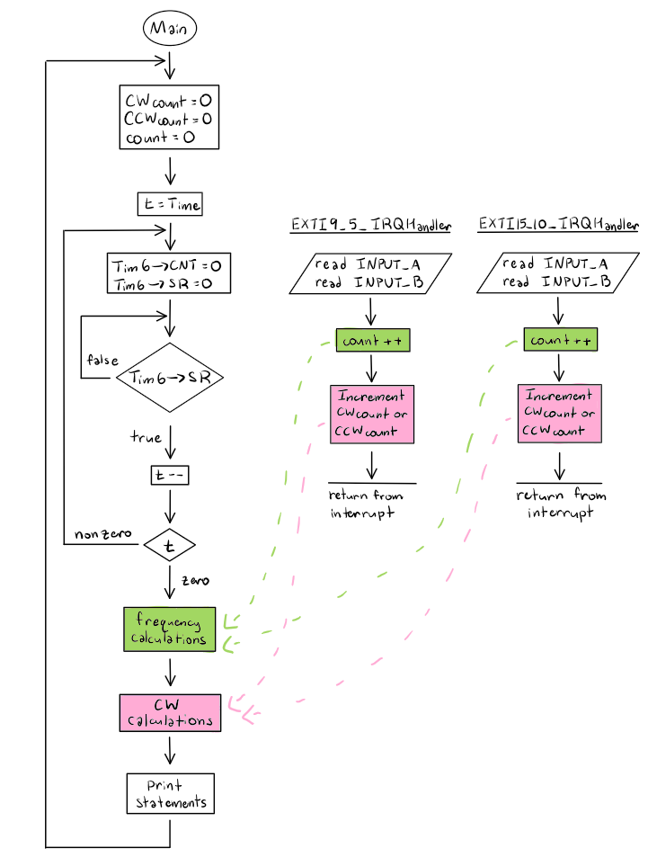
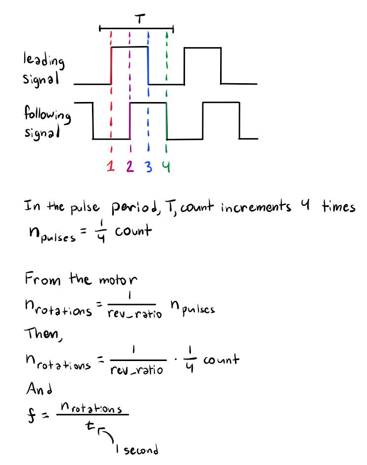
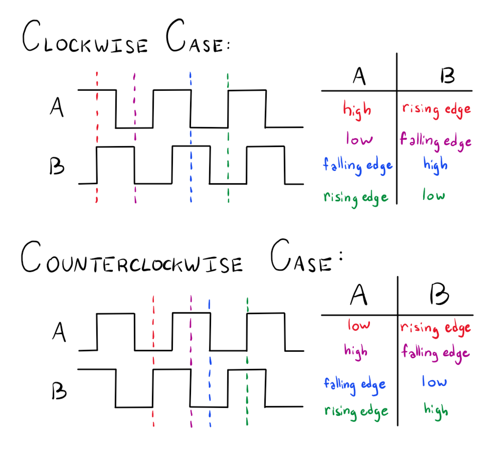
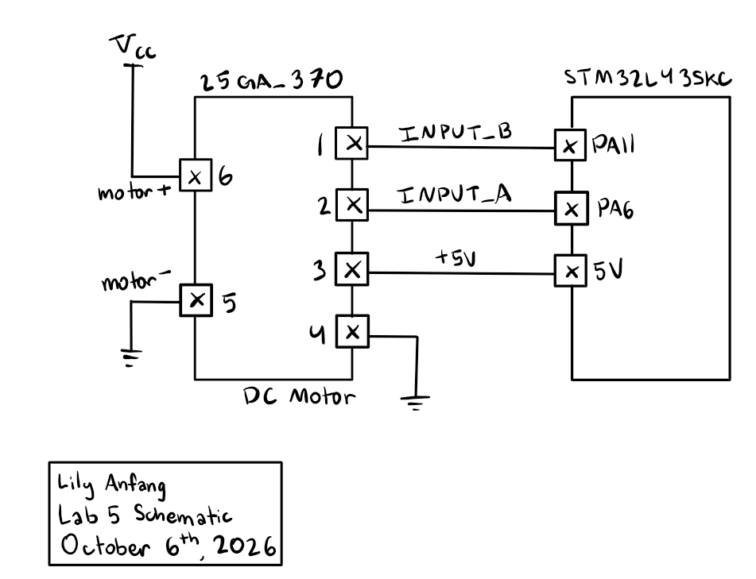

## Introduction
The goal of this lab is to understand how interrupts function. 

## Design and Testing Methodology
To convert from pulses out of the motor to tracking the revolutions per second I used two interrupts that triggered on the positive and negative edges of outputs A & B and implemented an in line counter. This resulted in 4 added to the counter for every one pulse. 
I then had a timer set to 1 second. Every second, the timer would use the counter value and divide the inline counter value by 4*REV_RATIO (the number of pulses per revolution) to calculate the total revolutions per second. 
To implement the tracking of rotational direction I tested at every interrupt the relative position of A to B to test if A or B was leading. I did this using the knowledge that at the rising edge of the leading wave the other would be low and at the falling edge of the leading wave the other would be high. 

## Technical Documentation

To count the edges, I used interrupts on both the A and B signals. As such, my main loop would stop what it was doing when an interrupt event occured, run the interrupt command, and then return to the process in the main loop. This allows the system to ensure that every edge is counted, allowing for the best possible accuracy in counting edges. However, the trade off is that the time spent handling the interrupt signal is not factored into the timing for the 1 second counter. As such, while the count per cycle will be correct, the cycle length may not be exactly 1 second. My interrupt design is shown below

::: {.callout-caution collapse="true" title="spoiler: Code flowchart"}

:::

To ensure the maximum possible accuracy, I used both edges on both A and B so that I would get 4 samples per pulse period. Then, I used the equation below to calculate motor speed. I also used the tables shown below to determine direction. 

::: {.callout-caution collapse="true" title="spoiler: Equation for calculating motor speed"}

:::

::: {.callout-caution collapse="true" title="spoiler: Motor direction graphics"}

:::

The board was wired to a 25GA-370 DC motor with a 120:1 pulse to revolution ratio as shown below. 

::: {.callout-caution collapse="true" title="spoiler: Circuit schematic"}

:::

## Code

[Lab 5 Repo](https://github.com/lilyanfang/hmc-e155-lab5)

## Hardware Results

The design is able to correctly identify direction and speed of the motor, meeting all specifications.

## Conclusion

In this lab I used interrupt to allow my MCU to determine the speed and direction a motor was spinning in based on the outputs of a quad encoder. I spent 16 hours on this lab. 

## AI Prototype Summary

After some additional prompting of the AI it was able to use EXTI to write the same interrupt handler that I initially used with some minor difference in syntax. However, its handler didn't work because it had the same flaw my initial code had where it didn't account for the waveforms not being perfectly square. As such, it would likely only be able to debug if it had the information I had from debugging. 