## Introduction

The goal of this lab is to construct a hardware accelerator that can run 128-bit AES encryption. The MCU should use SPI to send over plaintext and a cipher key and receive back ciphertext from a FPGA running the encryption software. 

## Design and Technical Documentation

For an 128-bit AES encryption, the AES standard has the following 10 round process. This process is performed on a 4 by 4 state matrix derived from the input plaintext. Each state is 2 bytes in length and is defined as state [r,c] where r is the row and c is the column. As such, bits [127:96] are the bits in states [0-3,0] respectively. Similarly, bits [95:64] are states [0-3,1], bits [63:32] are states [0-3,2], and bits [31:0] are states [0-3,3]. 

::: {.callout-caution collapse="true" title="spoiler: Round operations"}
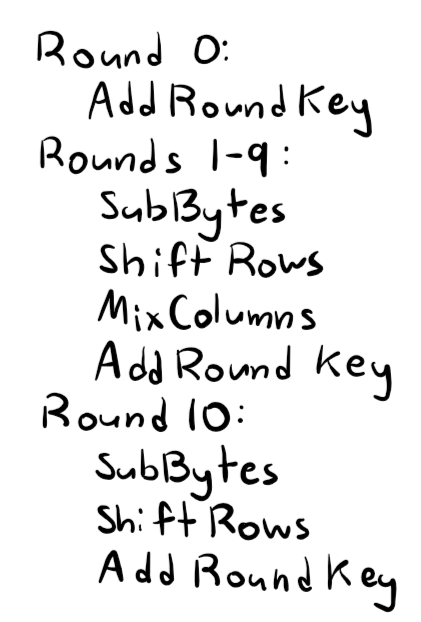
:::

The SubBytes module performs the SBox function on each state. SBox substitues each byte following a table that defines the output byte for any possible input byte. To do this without using up a significant number of LUTs on the FPGA, the code stores this table in RAM and uses a synchronous function to substitute each byte for its corresponding value from SBox. 

::: {.callout-caution collapse="true" title="spoiler: SubBytes block diagram"}
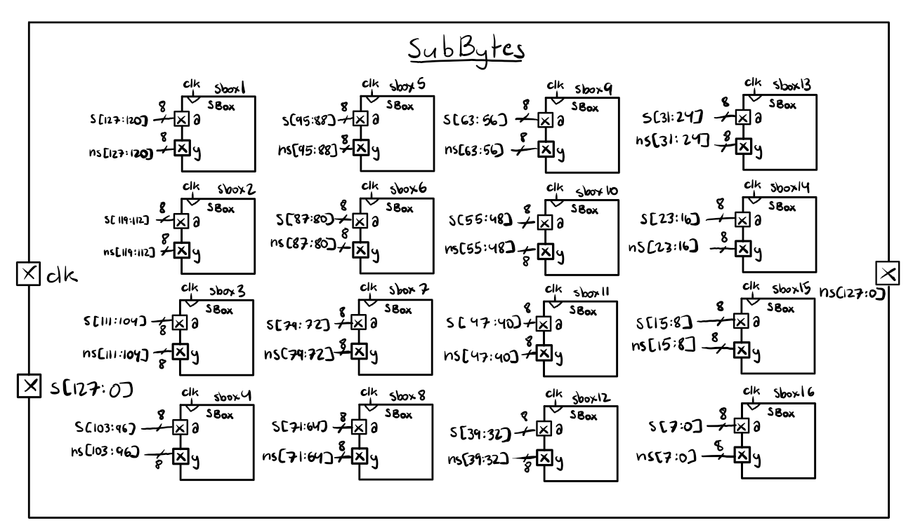
:::

The ShiftRows module shifts each row to the left by the row number with the leftmost state wrapping around to the rightmost position. As such row 0 does not change, row 1 has every state shift to the left by one, row 2 has every state shift to the left by two, and row three has every row shift to the left by three. This is done in hardware by directly wiring each state input to the appropriate state output. 

::: {.callout-caution collapse="true" title="spoiler: ShiftRows block diagram"}
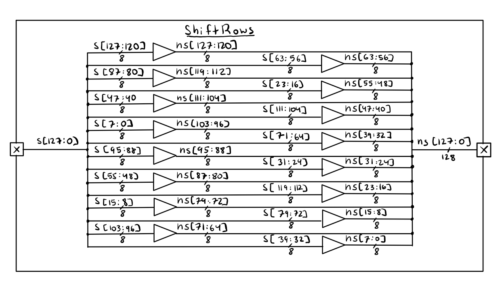
:::

The MixColumns module performs matrix multiplication on the state matrix with a set matrix. This code was premade for this lab. 

The AddRoundKey module XORs each column with the given word for that column and round. The word is calculated using the KeyExpansion Module. 

::: {.callout-caution collapse="true" title="spoiler: AddRoundKey block diagram"}
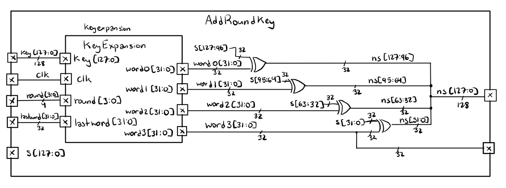
:::

The KeyExpansion module calculates the four words for a given round. For round 0, words 0-3 are just the words in the key. For every subsequent round, the words follow a disntictive pattern. Each word takes in a temp value, the word generated directly before it, and w[i-Nk], the word used on the same column in the prior round (the word 4 iterations prior). For the words applied to columns 1-3, the word is calculated by XORing the temp value with w[i-Nk]. For the words applied to column 0, the tamp value is first fed through RotWord, which moves the last two bytes from the back of the word to the front of the word. That output is then fed into SubWord, which applies SBox to each 2-byte chunk of the word. That output is than XORed with an Rcon value specific to the round. Finally, that value is used as the new temp value that is XORed with w[i-NK]. 

::: {.callout-caution collapse="true" title="spoiler: KeyExpansion block diagram"}
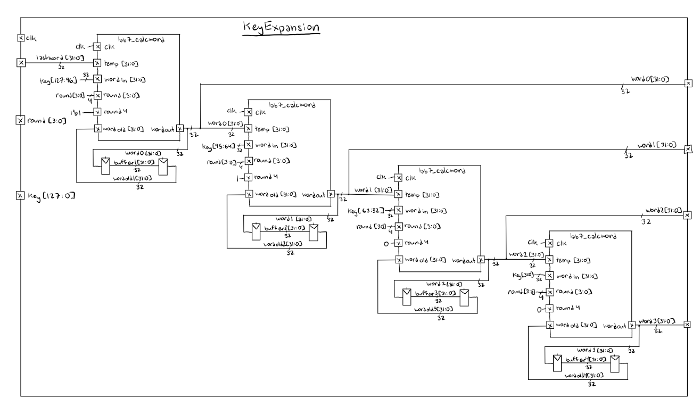
:::

::: {.callout-caution collapse="true" title="spoiler: CalcWord block diagram"}
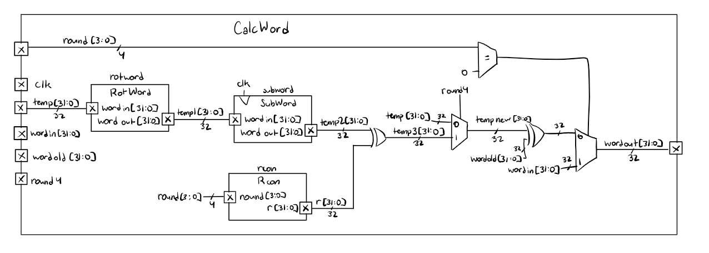
:::

The overall hardware then has the following design with the premade SPI module. 

::: {.callout-caution collapse="true" title="spoiler: AESCore block diagram"}
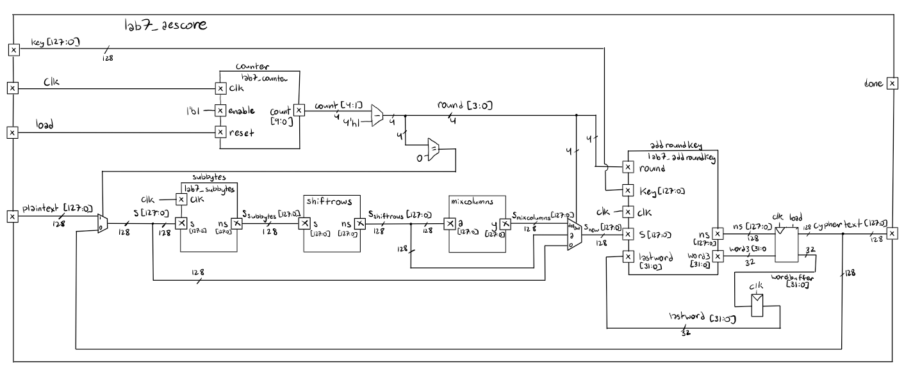
:::

::: {.callout-caution collapse="true" title="spoiler: AES top module block diagram"}
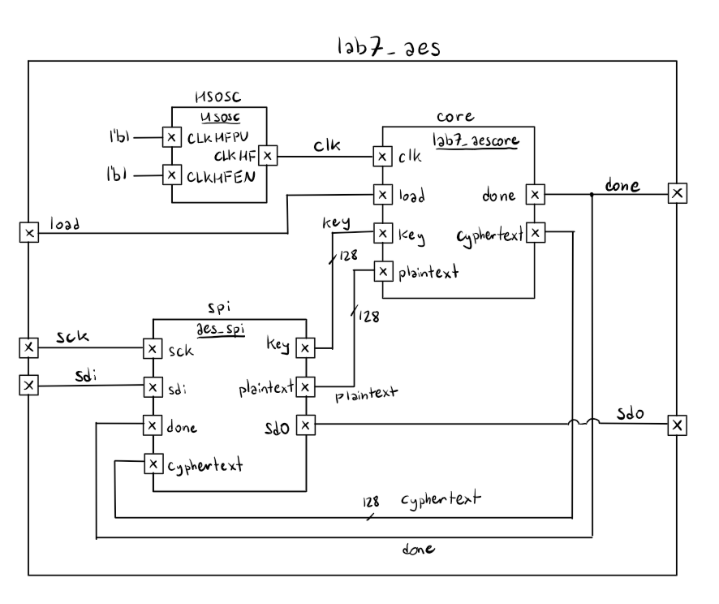
:::

## Software Test Results

Testing with the provided test benches shows that the code passes both test benches with the expected waveforms. The code is able to output the corrected text and successfully communicate through the SPI network. 

::: {.callout-important collapse="false" title="AEScore testbench waveform and output"}
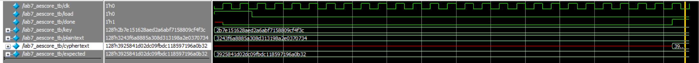
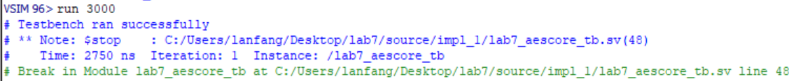
:::

::: {.callout-important collapse="false" title="AES testbench waveform and output"}
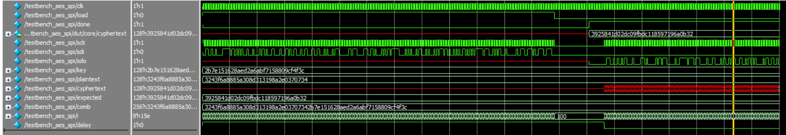
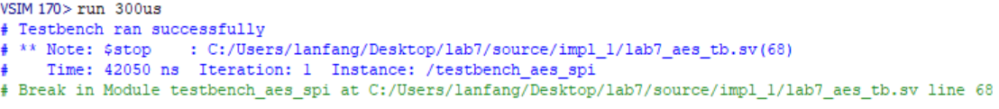
:::

## Code

[code](https://github.com/lilyanfang/hmc-e155-lab7)

## Hardware Results

When connected to hardware the device was able to fit on the board and successfully output, as indicated by the LED for pin PA9 activating. Additionally, the logic analyzer traces are shown below. 

::: {.callout-caution collapse="true" title="spoiler: Logic analyzer trace"}
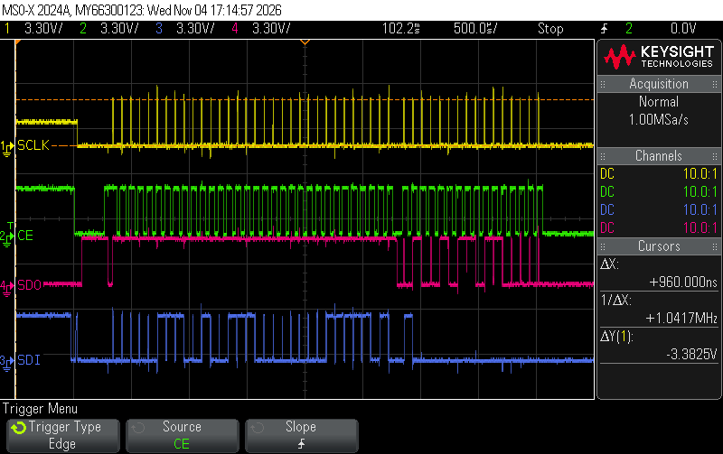
:::

## Conclusion

For this project I coded an FPGA to communicate over SPI with an MCU to run AES encryption on a 128-bit plaintext. I spent 17 hours on this lab. 

## AI Prototype Summary

For both of the code options generated by Gemeni it was able to do a pretty good job following the standard. When Gemeni didn't have access to the AES standard the code was somewhat worse but the idea was still there. The main issue was that across both cases Gemeni had some syntax issues that caused errors. Additionally, Gemeni had timing issues because it didn't account for any of the modules being synchronous and thus would have latency issues later on in implementation. 
